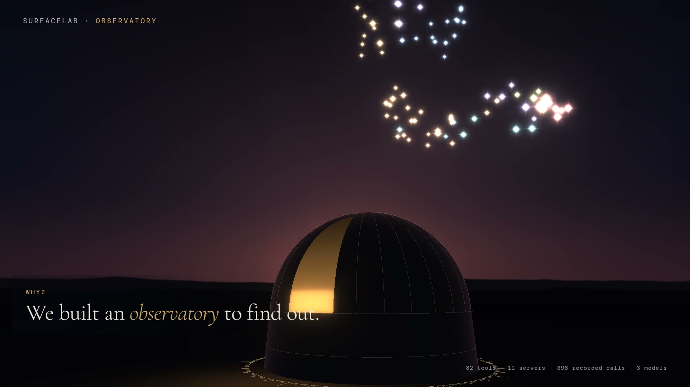

# surfacelab

**How do AI agents choose between MCP tools, and what makes them choose wrong?**

surfacelab is an open evaluation of tool choice in the Model Context Protocol: 12 preregistered experiments, 3 models, and 396 recorded calls on 82 tools from 11 real MCP servers. The results are drawn as an observatory you can explore: every star is a real tool, every beam a recorded call.

[](https://1ash0.github.io/surfacelab/)

**[Open the Observatory →](https://1ash0.github.io/surfacelab/)** · [Findings](docs/FINDINGS.md) · [Experiments](docs/experiments/) · [Decisions](docs/DECISIONS.md)

---

## What we found

| Finding | Evidence | Label |
|---|---|---|
| When each tool states one distinct job, the choice is near perfect and order, wording, 50 extra tools and namespacing barely matter | 99.6–99.9% accurate across all 24 orderings; gap −0.8 pp [−2.1, 0.0] | absent (at ceiling), replicated on Qwen |
| When tools do the same job, the first one listed wins | +10.4 pp [+2.1, +19.8] (gpt-oss-120b), +12.5 pp [+2.1, +25.0] (Qwen) | exploratory, replicated |
| On real servers loaded together, models miss the only right tool far more often | 0.78 / 0.77 (gpt-oss 20b / 120b), 0.91 (Qwen), vs 0.99+ on hand-written surfaces | below the 0.90 target |
| Wrong picks land on look-alike descriptions | 71st similarity percentile (p = 0.0007; 67th with a second embedding model) | exploratory |
| Installing a second browser server changes the first move | gpt-oss-120b opened 14 of 24 browser requests with Chrome DevTools' `list_pages`, including jobs only Playwright can do | exploratory, first call only |
| Which server wins a shared job is a model habit, not list order | +0.0 to +7.3 pp over chance; the winner changed with order in 19–25% of shared requests | inconclusive |

Intervals are 95%, clustered over request families (10,000 bootstrap resamples, seed 42). Every number cites a file in [`results/`](results/); the full table, with nulls and limits, is in [`docs/FINDINGS.md`](docs/FINDINGS.md).

**If you ship an MCP server:** make each tool's description say what makes it different; test the servers your users install together; watch the agent's first action, not just the final answer.

## The Observatory

A scroll-driven WebGL site, built from the recorded data with no backend.

| | |
|---|---|
|  |  |

- **Chapters:** the request the model reads, what didn't matter, ties (a 3D shuffle rack over all 24 orderings), real servers, who gets the call, a lab, the plate archive of all 14 experiments, how the intervals are made, and a bench for your own tool list.
- **Eyepieces:** click any star for its description, token spectrum, recorded calls and look-alikes; open any recorded call to see the exact ordered tool list the model saw and the raw call it returned.
- **Your server:** drop a `tools/list` JSON and see its token cost and the pairs most likely to be confused. Nothing leaves your browser.
- Dusk and Morning themes, deep links to any view, quality tiers, and a table fallback.

## How the evaluation works

- **Preregistered.** Each experiment fixes its hypothesis, sample size and verdict rule before any call ([`docs/experiments/`](docs/experiments/)); deviations are recorded after.
- **The right unit.** Analyses resample whole request families; repeated trials of one request are never treated as independent.
- **Validated answers.** For the follow-up experiments (EXP-009 to 013), gold labels were checked blind by a second person before runs; disagreements widen gold to the union.
- **Recorded, not re-rolled.** Every API response is cached by request hash; refusals are recorded and scored, never retried until the model complies. Temperature 0.
- **Safe probing.** Real servers run inside a no-network Docker sandbox, and only `initialize` and `tools/list` are ever sent; no tool is called.
- **Nulls are published** next to effects; one experiment (EXP-010) was stopped by its own preregistered ceiling rule before any call.

## Quickstart

Requires Python 3.12 and [uv](https://docs.astral.sh/uv/).

```bash
uv sync --all-groups
make check                                   # lint, types, 327 offline tests
uv run surfacelab inspect real_browser       # where a real loadout's tokens go
PYTHONPATH=scripts uv run python scripts/analyze_followups.py --exp 13   # re-derive EXP-013 from results/
python scripts/build_site.py                 # rebuild site/ from docs/design/
```

Probe a server you trust and snapshot its tools:

```bash
uv run surfacelab probe --server-name mine --snapshots-dir runs/mine -- <your server command>
```

**Reproducing from scratch.** `results/` and `runs/` are committed; the cached API responses (`cassettes/`, ~63 MB) are not. Analyses that read `results/` run offline; re-running experiments needs Groq API keys and a budget cap: every live run requires `--dry-run` first and `--max-usd`.

## Repository

```
src/surfacelab/     harness: surfaces, cases, grading, providers + cassettes, stats, sandboxed probe
scripts/            experiment runners, analyses, data and site builders, film renderer
fixtures/           surfaces (hand-written and real), cases, validated gold
results/  runs/     every recorded result and server snapshot cited in the docs
docs/               findings, preregistrations, decisions (ADRs), design, lab notebook
site/               the built Observatory (deployed to GitHub Pages)
tests/              offline tests
```

## Limits

Three open models (gpt-oss-20b, gpt-oss-120b, qwen3.8-27b) on one provider (Groq, free tier); results may differ for other models. EXP-013 has 48 request families, so its order-effect intervals are wide. Scoring uses the first call only, so multi-step recovery is not measured. Server snapshots are from 2026-10-28.

## Status

v0.1 evaluation complete. Next: confirm the two exploratory real-server findings in a preregistered run, measure the second call, add a second provider family, and a drift re-probe of the 19 servers ([`docs/ROADMAP.md`](docs/ROADMAP.md)).

Built by [@1Ash0](https://github.com/1Ash0). MIT licensed, see [LICENSE](LICENSE).
